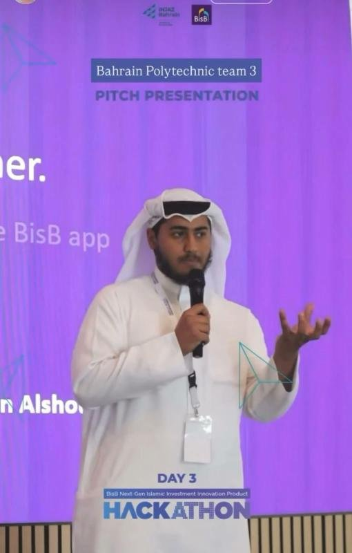

# Zumra Pool — BisB Next-Gen Islamic Investment Innovation Product Hackathon

**Pool small. Invest together.** A Sharia-compliant pooled investment feature for the Bahrain Islamic Bank (BisB) app.

- **Event:** BisB Next-Gen Islamic Investment Innovation Product Hackathon, 13–15 October 2026
- **Organizers:** Bahrain Islamic Bank (BisB) in collaboration with INJAZ Bahrain
- **Team:** Bahrain Polytechnic Team 3 — Ali Fadhul and Abdulrahman Alshoubaili
- **Role:** Co-designed the product and presented the pitch on Day 3; interviewed by Al-Watan about the experience

## Evidence

| Item | Link |
|---|---|
| Pitch deck (PDF) | [assets/Zumra_Pool_Pitch_Deck.pdf](assets/Zumra_Pool_Pitch_Deck.pdf) |
| Project web page | [index.html](index.html) |
| Certificate of participation | [assets/certificate.jpg](assets/certificate.jpg) |
| Pitch on Day 3 | [assets/pitch.jpg](assets/pitch.jpg) |

## The idea

Many first-time investors and salaried savers are held back by high minimum amounts, scattered products and unclear risks and fees. Zumra Pool lets BisB customers pool small amounts, starting from BD 10, into one professionally managed, Sharia-compliant portfolio inside the BisB app.

- **Three portfolios:** Zumra Stable (lower risk), Zumra Balanced (mixed) and Zumra Growth (higher growth, higher risk)
- **How it works:** invest from BD 10 with monthly auto top-ups → funds go into a segregated pool → a licensed manager invests per portfolio policy → profit is shared pro-rata, net of fees → exit within 14 days
- **Sharia structure:** Mudarabah, with investors as Rab al-Mal and BisB as Mudarib, investing in Sukuk, Murabaha, Ijarah and compliant equities, with no guaranteed return and approval by the Sharia board
- **Business model:** 1% annual management fee plus a 2% share of investment profit under the Mudarabah ratio
- **Feasibility:** built into the existing BisB app, fits CBB collective investment rules, with a cash and short-term Murabaha buffer to fund 14-day exits

